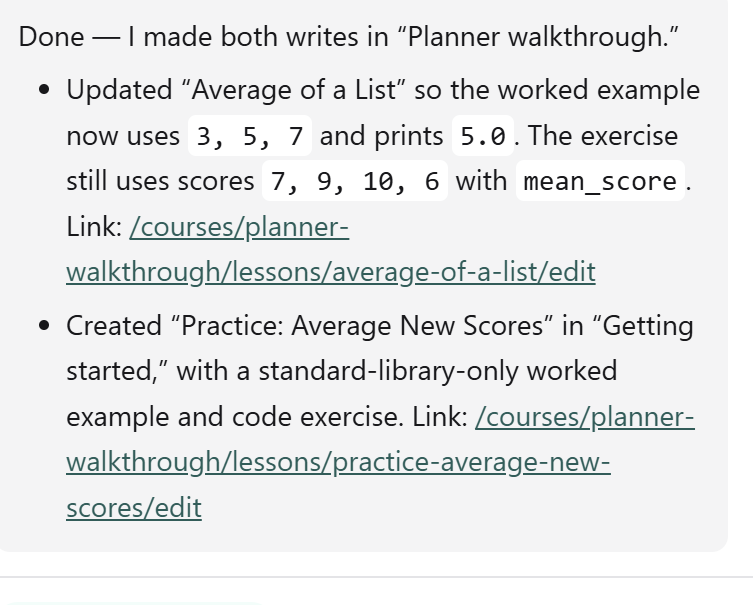
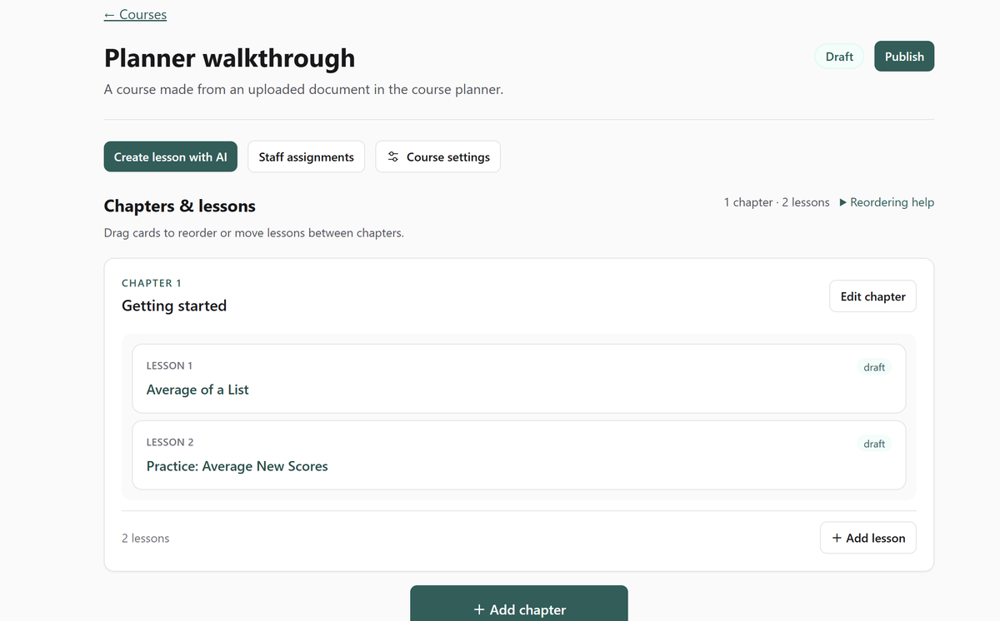
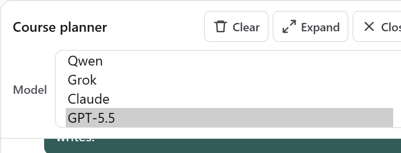
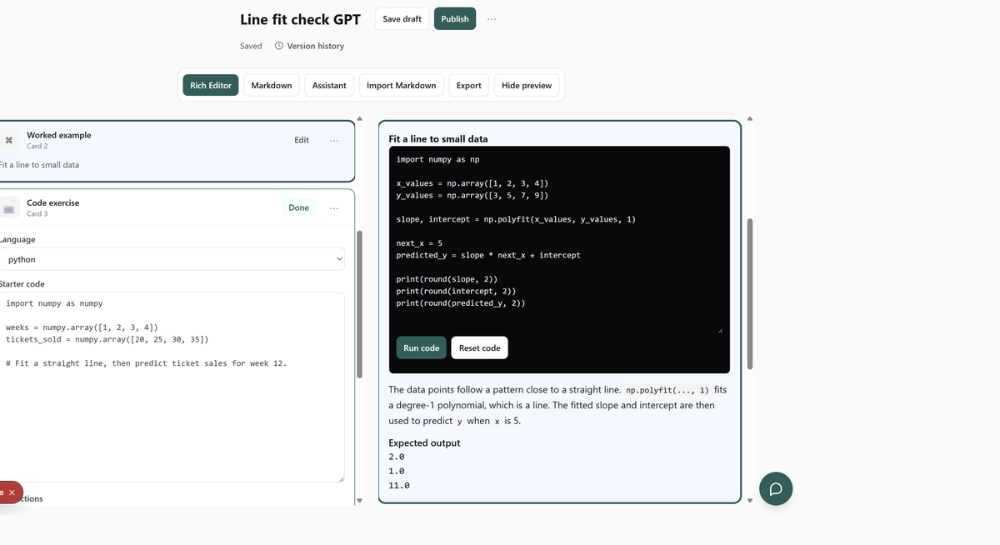
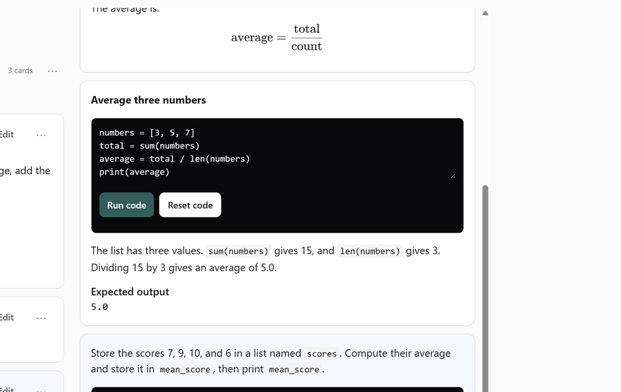

# What changed

## The chat can create and edit lessons

Ask the course planner to change a saved lesson or add another one. It writes the drafts and links you to them.

## An uploaded document becomes lessons in the course

Attach a text document and the planner uses it as the source. The lessons then show up in the course, ready to open.

## You choose which model writes the next lesson

The next message can use Qwen, Grok, Claude, or GPT-5.5. A lesson is checked against the lesson format before it is saved.

## Selecting a card selects the same block in the preview

Click a card and that block is selected on both sides, and the preview scrolls to it. Clicking the preview does the same for the card.

## A chat edit is the code the learner runs

Changing the example in the chat changes the saved lesson. The preview runs `numbers = [3, 5, 7]` and the expected output is 5.0.

